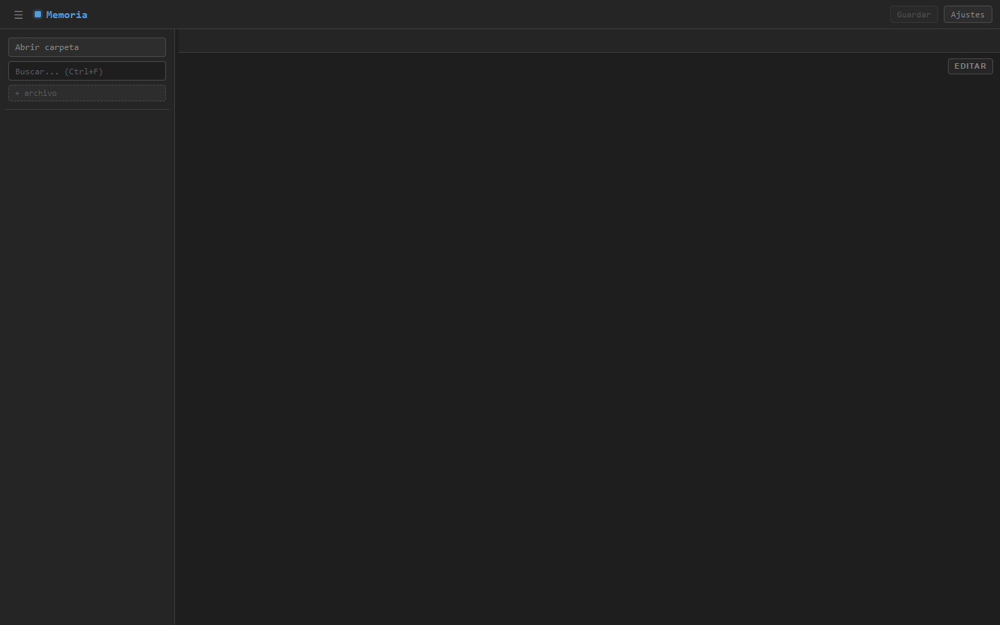
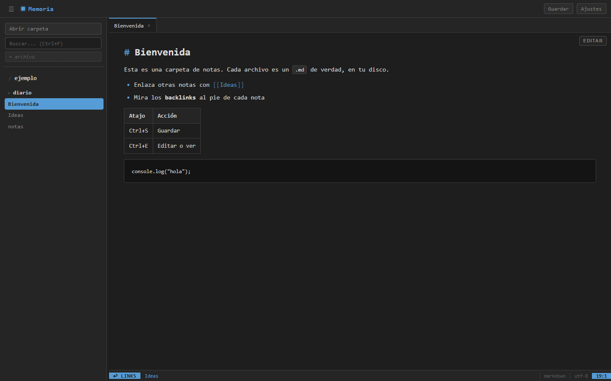
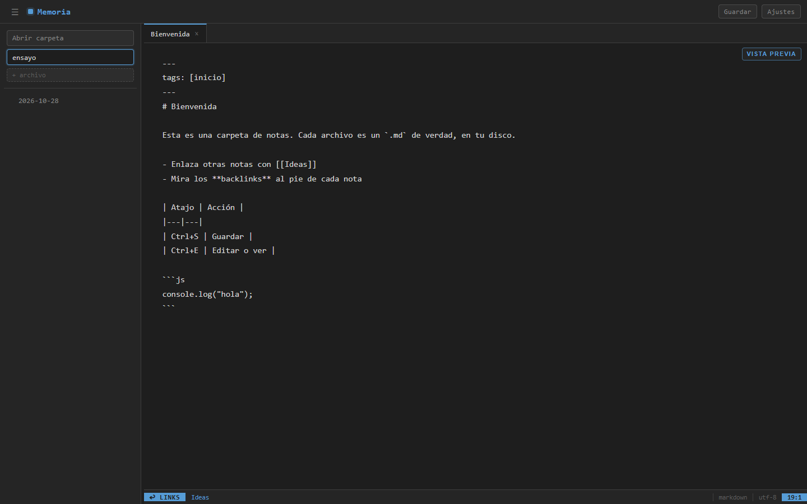
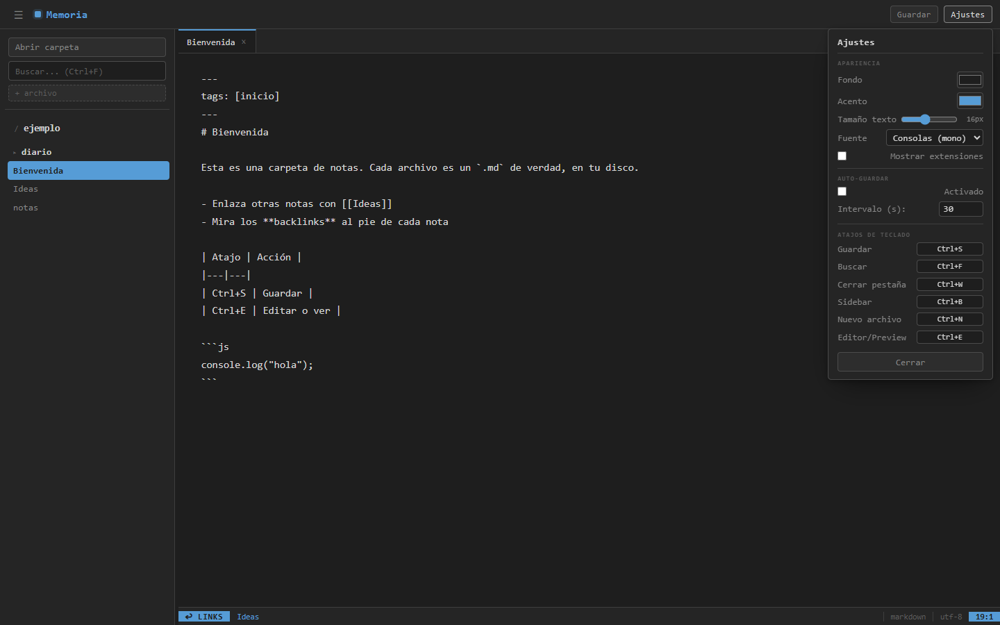

# Guía de memoria

Cómo se usa memoria para trabajar con una carpeta de notas. El [README](../../README.md) lista todo lo que hace; esta página es un recorrido corto.

memoria lee y escribe tus archivos directamente en el disco: no hay base de datos, ni servidor, ni cuenta. Funciona en **Chrome o Edge**, porque usa la File System Access API, que Firefox no tiene. Abre https://memoriainfinita.github.io/memoria/.

## Abrir una carpeta

Pulsa **Abrir carpeta** y elige la carpeta de tus notas: puede ser un vault de Obsidian o cualquier carpeta con archivos de texto. El navegador te pide permiso la primera vez. Al recargar la página, la sesión se restaura: la carpeta y las pestañas que tenías abiertas.

- El **árbol** de la izquierda muestra las carpetas y los archivos; los que memoria no sabe abrir salen atenuados
- Pulsa un archivo para abrirlo en una pestaña. Puedes tener varios abiertos a la vez
- El botón derecho sobre un archivo, una carpeta o una pestaña abre su menú: crear, duplicar, borrar, mover, y en las pestañas cerrar las demás o las de un lado. También se mueven arrastrando

## Leer y escribir

- Las notas Markdown se ven ya dibujadas: títulos, tablas, código resaltado y enlaces. El frontmatter YAML no se muestra
- **Editar** (arriba a la derecha, o `Ctrl+E`) pasa al texto sin procesar; **Vista previa** vuelve
- `[[nombre]]` enlaza con otra nota, y la barra de abajo lista los **backlinks**: las notas que enlazan con esta
- **Guardar** o `Ctrl+S` escribe el archivo. En Ajustes se puede activar el guardado automático, con su intervalo
- Los archivos de texto y de código se muestran tal cual, con el lenguaje resaltado; las imágenes, el audio, el vídeo y los PDF se previsualizan en modo de solo lectura
- Si el archivo cambia fuera de la app mientras lo tienes abierto, memoria lo avisa

## Buscar

El campo de arriba (`Ctrl+F`) busca por nombre y por contenido en toda la carpeta. Escribe, y el árbol se sustituye por los resultados.

## Ajustes

El botón **Ajustes** abre el panel: el color de fondo y el de acento, el tamaño y la fuente del texto, si se muestran las extensiones, el guardado automático y los atajos de teclado, que se pueden cambiar.

| Atajo | Acción |
|---|---|
| `Ctrl+S` | Guardar |
| `Ctrl+F` | Buscar |
| `Ctrl+W` | Cerrar pestaña |
| `Ctrl+B` | Mostrar u ocultar el árbol |
| `Ctrl+N` | Nuevo archivo |
| `Ctrl+E` | Alternar editor y vista previa |
